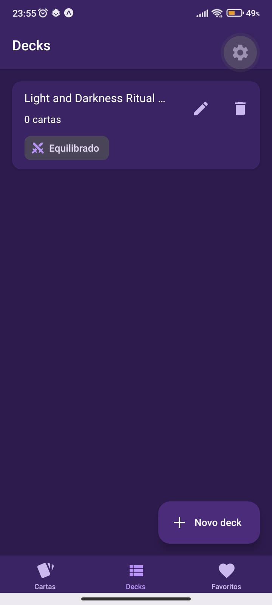
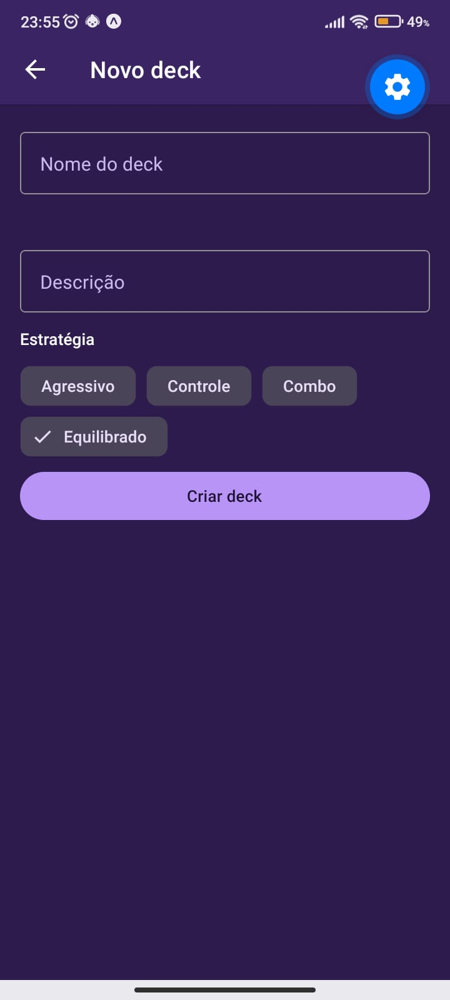
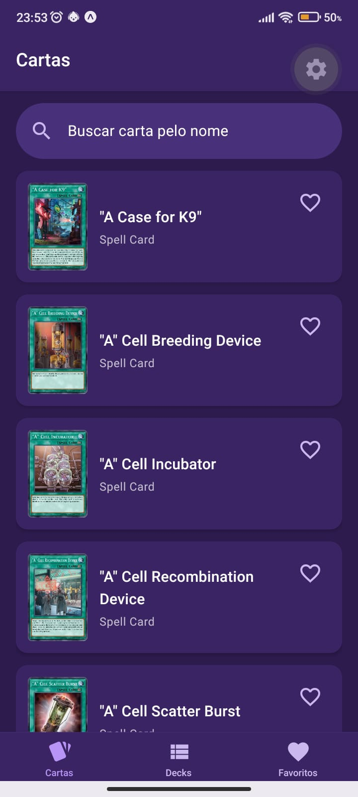

# YGO Decks (app)

Aplicativo mobile feito com **React Native + Expo** para consultar cartas de Yu-Gi-Oh! e
gerenciar decks. É a parte *frontend* de um projeto full stack.

O backend está em outro repositório: https://github.com/alef-coder/ygo-decks-api

## Funcionalidades

- **CRUD de decks** (salvo no backend): criar, listar, editar e excluir
- Lista de cartas da API pública [YGOPRODeck](https://ygoprodeck.com/api-guide/), com busca por nome e rolagem infinita
- Tela de detalhes da carta
- Favoritos salvos no celular com AsyncStorage
- Navegação por abas e telas empilhadas (React Navigation)
- Interface com React Native Paper e tema roxo

## Tecnologias

- React Native e Expo
- React Navigation
- React Native Paper
- AsyncStorage

## Pré-requisitos

- Node.js instalado (versão LTS)
- App **Expo Go** no celular
- O backend rodando (veja o README do backend)
- Celular e computador **na mesma rede Wi-Fi**

## Como rodar

1. Suba o backend primeiro, seguindo o README do repositório `ygo-decks-api`.

2. Clone este repositório e instale as dependências:

```bash
git clone https://github.com/alef-coder/ygo-decks-app.git
cd ygo-decks-app
npm install
```

3. Inicie o app:

```bash
npx expo start --go
```

4. Escaneie o QR code com o Expo Go.

### Conexão com o backend

O app descobre sozinho o IP do computador (o mesmo que serve o Expo) e acessa o backend
na porta `3000`. Se a conexão falhar, abra o arquivo `config.js` e preencha `URL_MANUAL`
com o IP do computador, por exemplo `http://192.168.0.105:3000`
(use `ipconfig` no Windows para descobrir).

## Estrutura

```
├── components/   # CartaCard
├── context/      # FavoritosContext (AsyncStorage)
├── screens/      # Cartas, Decks, DeckForm, Detalhes, Favoritos
├── services/     # ygoApi (YGOPRODeck) e decksApi (backend)
├── config.js     # URL do backend
├── theme.js      # tema roxo do Paper
└── App.js        # navegação e providers
```

## Prints



